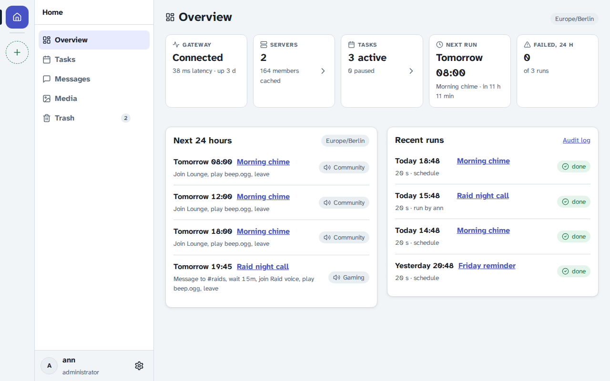

# pts-discord-bot

Cloudron app with a Discord bot and a web UI to control it. Sign in with your Cloudron account.

* Tasks on a schedule (daily, weekly, once, cron), on Discord events (voice joins and leaves, new members, message keywords) or on demand: join a voice channel, play sounds, send messages and direct messages, wait, leave
* Slash commands: /play, /task, /stop, /leave
* Saved messages with embeds, images and files, with a preview
* Media library for sounds, images, videos and files, with tags and random sounds per tag
* Servers and channels the bot sees, with the bot's missing permissions
* Member search when picking who gets a direct message, whose voice channel to join, or whom to mention
* Run history, failure posts to a channel, audit log

## Install

In Cloudron, open 'Add custom app' and enter `https://raw.githubusercontent.com/BrutalBirdie/pts-discord-bot/master/CloudronVersions.json`.

1. Create a bot in the [Discord Developer Portal](https://discord.com/developers/applications). Under **Bot**, copy the token and switch on **Server Members Intent** and **Message Content Intent**.
2. Open `/app/data/env.sh` in the File Manager of the app. Set `DISCORD_TOKEN`, and `BOT_ADMINS` or `BOT_ADMIN_GROUP`. Restart the app.
3. Sign in, open **Servers** and add the bot to your server with the invite link.

Every Cloudron user with access to the app can use it. Only admins see the Admin page.

## Discord login

Optional. Members of the servers the bot is in log in with Discord and ask for access to some of those servers. An admin approves, denies or blocks them under **Admin > Access**. An approved member manages the tasks, messages and media of the approved servers and plays sounds there. Messages and media without a server are shared and only Cloudron users see them. Admin pages and deleting from the Trash for good stay with Cloudron admins.

1. In the [Discord Developer Portal](https://discord.com/developers/applications), open the bot's application, then **OAuth2**. Add the redirect `https://<app domain>/auth/discord/callback` and copy the **Client Secret**.
2. Set `DISCORD_CLIENT_SECRET` in `/app/data/env.sh` and restart the app.

Changes per version are in the [releases](https://github.com/BrutalBirdie/pts-discord-bot/releases).

## Upgrading from 0.2

Sound files in `/app/data/sounds` move into the media library on the first start. The HTTP API (`POST /play`) and the n8n workflow are gone: recreate the schedule as a task. The old Adhan workflow is a daily task with the times `05:00 11:50 14:00 16:35 18:15`, timezone `Europe/Berlin`, and the steps Join voice channel, Play sound, Leave voice channel.

## Discord permissions

The bot needs View Channel, Send Messages, Embed Links and Attach Files in text channels, and View Channel, Connect and Speak in voice channels. The invite link asks for all of them.
